# ハンズオン手順書：Git × Docker × CI/CD を自分のリポジトリで動かす

DevOps全体像理解研修（2026年11月26日）のデモを、自分の GitHub アカウントで再現する手順です。
研修での講師のデモも、この手順どおりに進めます。所要時間は30〜40分です。

> 画面の写真は講師のリポジトリ（mk-lsb/DevOps1126）で撮ったものです。ユーザー名やコミットIDは、皆さんの画面では違う値になります。

---

## 0. ゴール

最後に、GitHub Actions の画面で次の3つの結果が並びます。

| ブランチ | 環境 | DB接続先 | パスワード | ビルド |
|---|---|---|---|---|
| `dev` | development | development-db | 設定なし | 1a2b3c4（例） |
| `verification` | staging | staging-db | 設定なし | **1a2b3c4（同じ）** |
| `main` | production | production-db ※ | 設定なし ※ | **1a2b3c4（同じ）** |

- **ビルド** はイメージを作るときに焼き込んだ値 → どの環境でも同じ。実際には自分のコミットIDの先頭7桁が出ます
- **環境・DB接続先・パスワード** は起動するときに渡した値 → 環境ごとに違う
- ※ 手順5の（任意）で production に `DB_HOST` と `DB_PASSWORD` を入れた場合は、入れた値（例：`prod-db.internal`）と「設定あり」になります。**本番の設定画面に入れた値だけが本番で効く**ことが分かります
- Summary にはこのほか、手順7で足した「メッセージ」と、使ったイメージの名前も表示されます

つまり「ブランチはイメージの出どころ。環境の違いは環境変数」を、自分の目で確かめます。

---

## 1. 用意するもの

| もの | 確かめ方 |
|---|---|
| GitHub のアカウント | 個人のアカウントで構いません |
| Git | ターミナルで `git --version` |
| Rancher Desktop（または Docker Desktop） | `docker version`。手順3（手元で動かす）だけで使います |
| ターミナル | Windows は PowerShell、Mac はターミナル |

> **会社のPC・アカウントで行う場合**：この手順では**公開（Public）リポジトリ**を作ります。社内のルールを確かめてから進めてください。

---

## 2. ファイルを手に入れる

1. https://github.com/mk-lsb/DevOps1126 を開く
2. 緑の **Code** ボタン → **Download ZIP**
3. ZIP を展開し、フォルダ名を `DevOps1126` にする（`DevOps1126-main` になっていたら名前を変える）
4. ターミナルでそのフォルダに移動する

```
cd ~/Downloads/DevOps1126
```

> `git clone` ではなく ZIP を使うのは、講師のリポジトリの履歴を持ち込まず、まっさらな状態から始めるためです。

---

## 3. 手元で動かす（個別ブランチの世界）

各自のPCでは、ソースをコンテナに**直接つないで**動かします（バインドマウント）。

```
docker compose up --build
```

ブラウザで http://localhost:8000 を開くと、次のように表示されます。

```
環境       : local
DB接続先   : localhost
パスワード : 設定なし
ビルド     : local
```

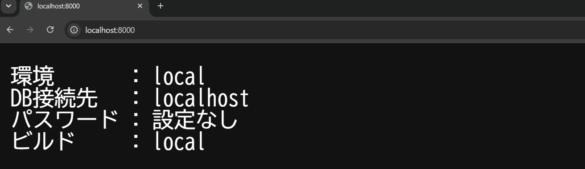

`app/app.py` を書き換えて、別のターミナルで `docker compose restart` を打つと、イメージを作り直さなくても変更が反映されます。
終わったら `Ctrl+C`（Mac も control キー）で止め、`docker compose down` で片付けます（コンテナは消え、イメージは残ります。次に `docker compose up` するときに速く起動します）。

> **試しに書き換えた `app/app.py` は、元に戻してから手順6へ進んでください。** 書き換えたまま最初の push をすると、その変更も一緒に入ります。テストが通らない形に変えていると、手順7で失敗します。

---

## 4. 自分のリポジトリを作る

1. GitHub 右上の **＋** → **New repository**
2. Repository name：好きな名前（例：`DevOps1126`）
3. **Public** を選ぶ
4. README・.gitignore・ライセンスは**追加しない**（空のまま）
5. **Create repository**

> Public にするのは、手順5の「承認待ち」が、無料・Pro・Team プランでは公開リポジトリでしか使えないためです。

---

## 5. 本番環境に承認者を付ける（push より先に！）

1. 作ったリポジトリの **Settings** → 左の **Environments** → **New environment**
2. Name に `production` と入れて **Configure environment**
3. **Required reviewers** にチェックを入れ、自分のユーザー名を追加
4. **Save protection rules**

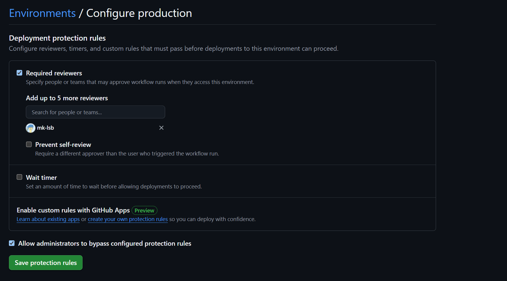

保存すると、Environments の一覧に `production` と「1 protection rule」が表示されます。

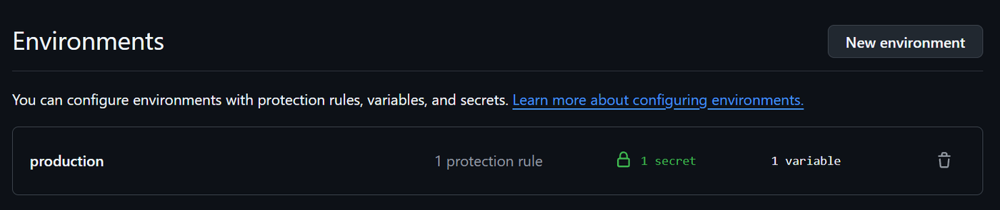

> 先にやらないと、本番へのデプロイが承認なしで流れてしまいます。
> `development` と `staging` は、最初にワークフローが動いたときに自動で作られます。

**（任意）環境ごとの値を入れてみる**

各 Environment の **Environment variables** に `DB_HOST`、**Environment secrets** に `DB_PASSWORD` を追加すると、その値で起動します。パスワードは画面に「設定あり」とだけ出て、値は表示されません。

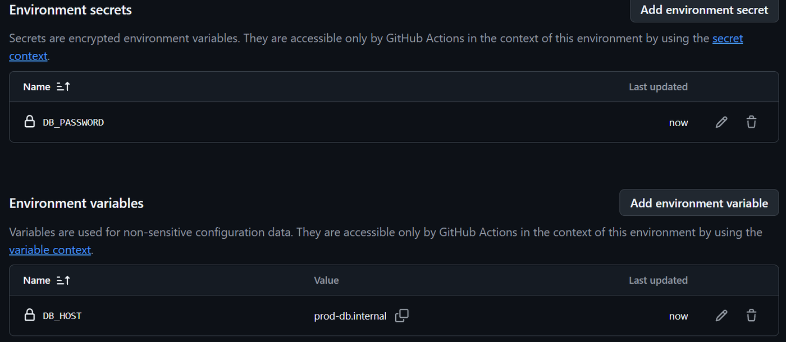

> 値は必ずダミーにします。Variables の値はログにそのまま表示され、Secrets は自動で `***` に伏せられます。パスワードは Secrets に入れてください。

---

## 6. 最初の push（CI を止めて）

`<ユーザー名>/<リポジトリ名>` は自分のものに置き換えてください。

```
git init
git add .
git commit -m "初期構成 [skip ci]"
git branch -M main
git remote add origin https://github.com/<ユーザー名>/<リポジトリ名>.git
git push -u origin main
git push origin main:dev
git push origin main:verification
```

- `[skip ci]` を付けると、この push ではワークフローが動きません。まだイメージが無いので、ここで動くと「イメージがありません」で失敗するためです
- GitHub の画面（ブランチの一覧）で、`main` `dev` `verification` の3つになっていれば成功です。**綴りに注意**（`varification` などになっていると、手順8で何も動きません）

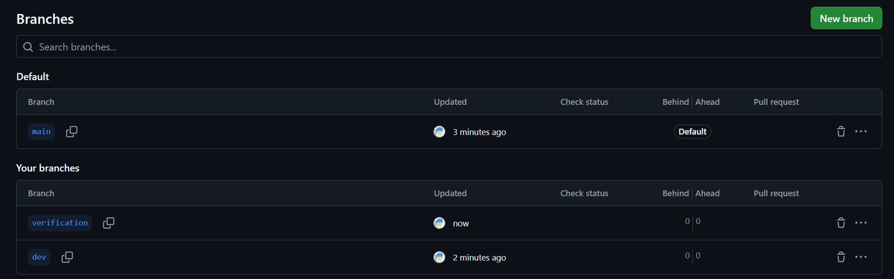

- `git commit` で名前とメールを聞かれたら、`git config --global user.name "名前"` と `git config --global user.email "メール"` を先に設定します
- push でパスワードを聞かれたら、GitHub のパスワードではなく **Personal access token** を入れます（Windows の Git は、ブラウザでのサインイン画面が出ることが多いです）

---

## 7. dev に変更を入れる → ビルドが動く

```
git switch dev
```

`app/app.py` の `lines = [` の中、`ビルド` の行のすぐ下に1行足します。

```python
        f"ビルド     : {env.get('APP_VERSION', 'local')}",
        "メッセージ : はじめてのデプロイ",
```

```
git add .
git commit -m "メッセージを追加"
git push
```

リポジトリの **Actions** タブを開くと、**テスト → ビルド（devのときだけ） → デプロイ** の順に動きます（2〜3分）。

**ここで見るところ**

- **ビルド** のログ：`-t ghcr.io/.../...:コミットID` のように、コミットIDの札（タグ）が付いている
- 実行結果のページ下の **Summary**：`環境 : development` と、`ビルド : 7桁のコミットID`

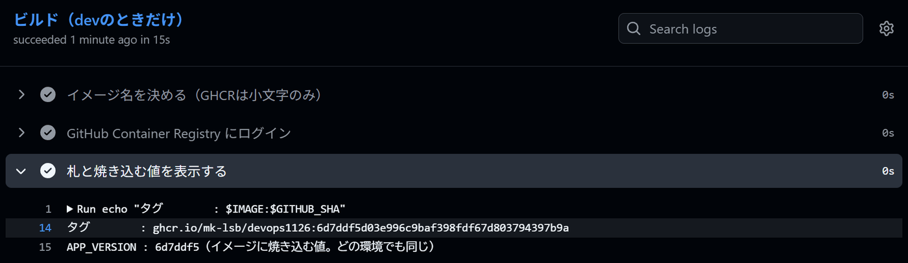

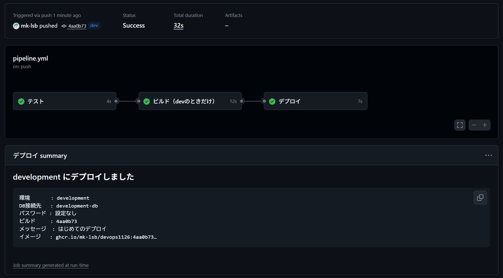

---

## 8. 検証へ進める（ビルドしない）

```
git push origin dev:verification
```

Actions で **テスト → デプロイ** が動きます。**ビルドは灰色（スキップ）** になります。

**ここで見るところ**

- Summary：`環境 : staging`、`DB接続先 : staging-db`
- `ビルド` のコミットIDが、手順7と**同じ**

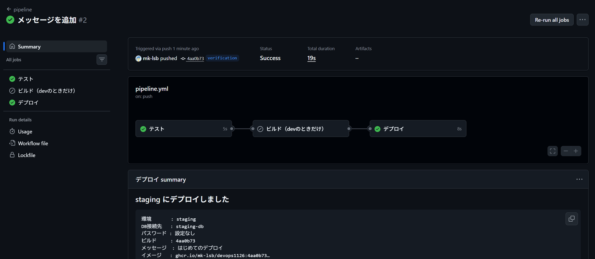

---

## 9. 本番へ進める（承認してから出す）

```
git push origin origin/verification:main
```

（`origin/verification` は「GitHub 上の verification」という意味です。検証に置いたものを、そのまま本番へ進めます）

Actions で **デプロイ** が **Waiting** で止まります。

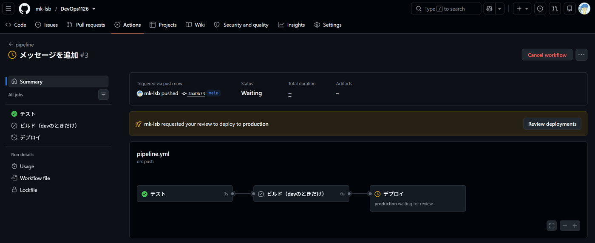

1. 実行結果のページで **Review deployments**
2. `production` にチェック
3. **Leave a comment** に、何を確かめて承認したかを1行書く（例：`検証環境で動作確認済み。ビルド 4aa0b73 を本番へ。`）。承認の記録として残ります
4. **Approve and deploy**

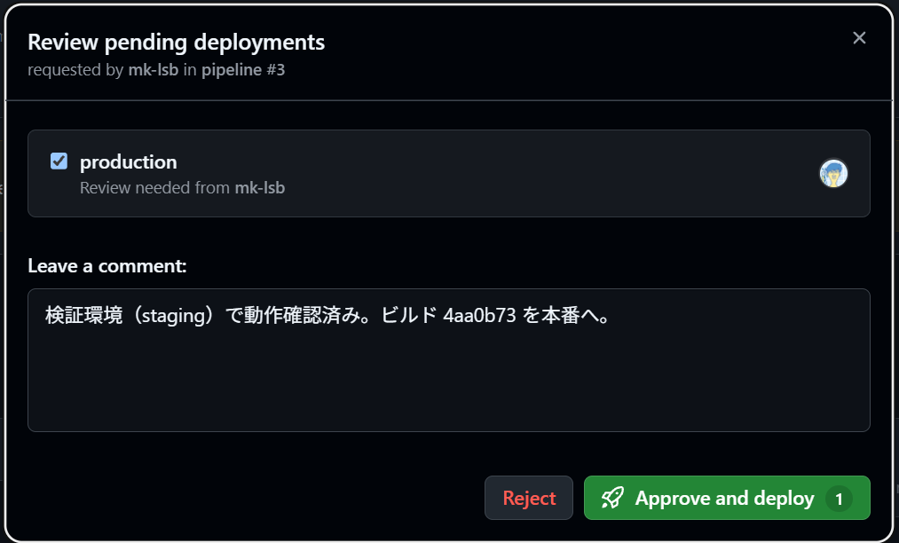

**ここで見るところ**

- 承認するまで本番に出ない
- Summary：`環境 : production`、`ビルド` は手順7・8と**同じ**
- 手順5で本番に値を入れた場合は、`DB接続先` がその値、`パスワード : 設定あり` になる

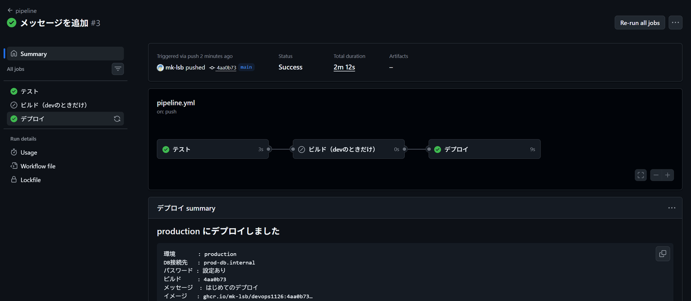

---

## 10. 3つの結果を並べる

Actions の一覧から3つの実行を開き、Summary を見比べます。手順0の表と同じになっていれば完了です。

Actions の一覧では、同じコミットIDが `dev` → `verification` → `main` の順に並びます。下の写真は2回繰り返したところで、変更するたびに新しいイメージが1つでき、それが3つの環境を順に進んでいくのが分かります。

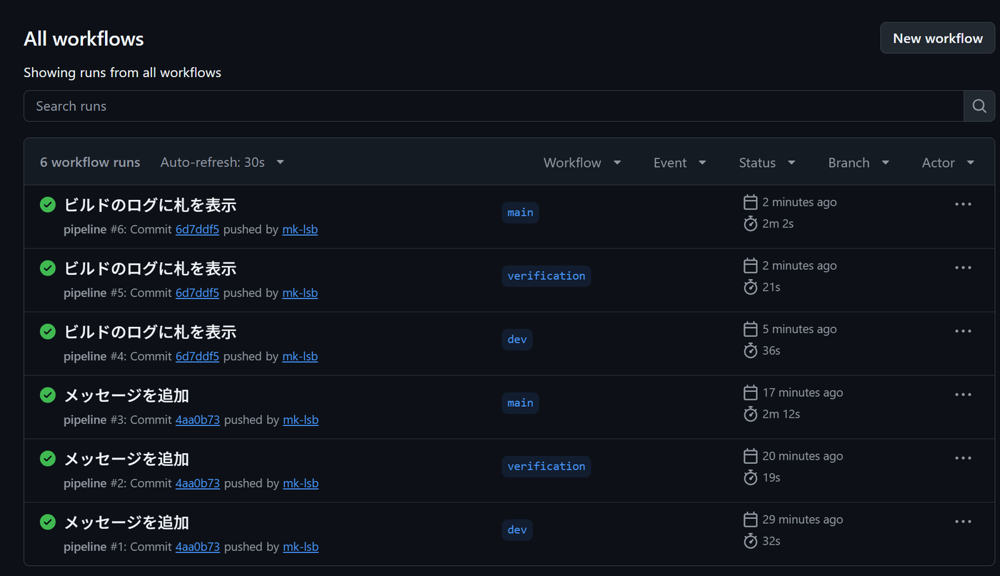

もう一度試すときは、手順7〜9を繰り返します（dev で変更 → `dev:verification` → `origin/verification:main`）。

---

## 11. うまくいかないとき

| 症状 | 原因と対処 |
|---|---|
| デプロイが「このコミットのイメージがありません」で止まる | dev でビルドしたものと違うコミットを進めた。PR でマージした・verification や main に直接コミットした場合に起きます。dev に変更を push してビルドしてから、手順8・9のコマンドで進め直す |
| push しても Actions が動かない | 最後のコミットに `[skip ci]` が付いている。変更を加えてもう一度コミットする |
| push すると「Select an account」で自分のアカウントが出ない | このPCのGitが別のアカウントだけを覚えている。**Add a new account** で自分のアカウントでサインインする。毎回選択画面が出るのを避けるには `git remote set-url origin https://<ユーザー名>@github.com/<ユーザー名>/<リポジトリ名>.git` |
| verification や main に push しても Actions が動かない | ブランチ名の綴り違い（例：`varification`）。ワークフローは `dev` `verification` `main` の3つだけに反応する。`git push origin --delete 間違えた名前` で消して、正しい名前で push し直す |
| 承認待ちにならず本番に出た | 手順5の設定が無い、またはリポジトリが Private |
| `git push origin verification:main` で `src refspec ... does not match` | 手元に verification ブランチが無いため。手順9のとおり `origin/verification:main` と書く |
| ビルドで `denied` などの権限エラー | リポジトリの Settings → Actions → General で、Actions が許可されているか確かめる |
| 手順3で `port is already allocated` | 8000番を他のアプリが使っている。`compose.yaml` の `"8000:8000"` を `"8080:8000"` にして、http://localhost:8080 を開く |

---

## 12. 後片付け

- **リポジトリ**：Settings → 一番下の Danger Zone → **Delete this repository**
- **イメージ**：自分のプロフィール → **Packages** → 該当のパッケージ → **Package settings** → **Delete this package**

---

## 13. 次の一歩

このデモは「1回ビルドして運ぶ」流派で、ブランチをそのまま進める（fast-forward）前提です。
実際の運用で PR を使ってマージする場合や、設定がビルド時に焼き込まれるアプリの場合は、README の「注意：PR でマージする場合」を読んで、どちらの流派にするかをチームで決めてください。
